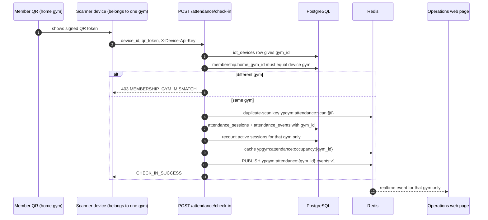
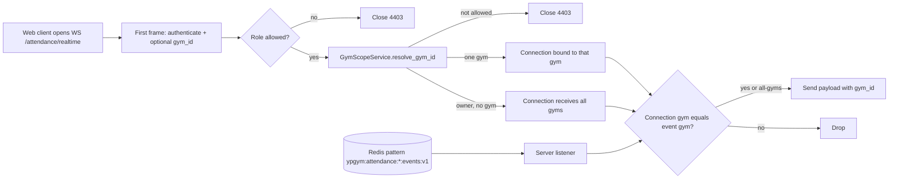

# Multi-gym flows: scan to occupancy, and realtime scope

Verified against `backend/app/services/attendance_service.py`, `attendance_realtime_service.py` and `backend/app/api/v1/endpoints/attendance_realtime.py`. This page is separate from `system-architecture.md` on purpose; fold it in when that file is free of other edits.

## Scan to gym-scoped occupancy

PostgreSQL is the source of truth. Redis holds only the 30-second occupancy cache, the duplicate-scan guard and the realtime channel. Check-out reads the session and refuses with `403 ATTENDANCE_GYM_MISMATCH` when the scanner belongs to another gym.

## Realtime socket scope

A manager or staff socket is bound to the assigned gym. A member socket is bound to the home gym. Only the owner may leave the gym open. The web client also checks the event's `gym_id` against the gym on screen and ignores a mismatch (`invalidateAttendanceQueries(client, eventGymId)`).

## Cache and channel keys

| Key or channel | Purpose |
|---|---|
| `ypgym:attendance:occupancy:{gym_id}` | 30-second occupancy cache, per gym |
| `ypgym:attendance:{gym_id}:events:v1` | Realtime channel, per gym |
| `ypgym:attendance:*:events:v1` | Listener subscription pattern |
| `ypgym:analytics:summary:` plus gym and revenue flag | 60-second analytics cache; owner and manager responses are cached separately |
| `ypgym:attendance:scan:{jti}` | Duplicate scan guard |
